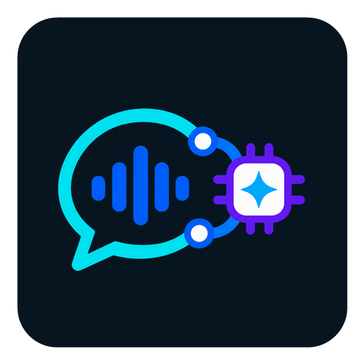

# Vox AI Relay



**Vox AI Relay** is a native Android voice and text communicator for two AI backends: **OpenClaw Gateway** and **Hermes Agent**. The backend switch is always visible, and the last selection is remembered.

The application keeps microphone audio on the phone whenever Android provides on-device speech recognition. It sends recognized text, attachments, and conversation requests to the backend selected by the user.

[Polska dokumentacja](README.pl.md)

## Main features

- Native Kotlin application for Android 10 or newer (`minSdk 29`).
- OpenClaw and Hermes backend selector with persistent last choice.
- Progressive response display and sentence-by-sentence Android TTS.
- Android speech recognition with an on-device preference and an explicit network fallback setting.
- Barge-in: the microphone button stops the current AI turn and immediately starts listening.
- Stop button: stops the current AI turn and TTS without opening the microphone.
- Conversation continuity and server-side history restoration.
- Photos, camera capture, files, and PDF attachments.
- English and Polish interface, light and dark themes.
- Optional Android assistant role and press-and-talk invocation.

## OpenClaw functionality

The OpenClaw connection uses the authenticated Gateway WebSocket protocol rather than a simplified proxy.

- challenge-bound Ed25519 device identity;
- bootstrap token or password for first pairing;
- reusable device token stored with Android Keystore-backed protection;
- `chat.history`, `chat.send`, and `chat.abort` support;
- streamed assistant text with session and run correlation;
- recent conversation selection and inactivity-based session rotation;
- file and image attachments sent through the Gateway;
- optional notification node, visible notifications, and urgent alarms;
- reconnect support for temporary network or Gateway interruptions.

OpenClaw remains the authoritative source of conversation history. The Android timeline is a projection of Gateway state.

### OpenClaw setup

1. Configure an authenticated OpenClaw Gateway.
2. Enter its `wss://` URL and bootstrap credential in Vox AI Relay settings.
3. Connect the application.
4. If pairing is requested, run `openclaw devices list` on the Gateway host and approve only the request ID shown by the phone.
5. For notification support, also approve the node capabilities described in the in-app help.

## Hermes functionality

Vox AI Relay connects directly to the authenticated Hermes API server.

- streaming `/v1/chat/completions` responses;
- durable transcript continuity through `X-Hermes-Session-Id`;
- separate stable `X-Hermes-Session-Key` scope for long-term memory;
- restoration of the latest server-side messages;
- streamed reasoning and tool-activity indicators without exposing raw tool-call markup;
- real interruption by closing the active SSE request;
- Hermes Vision for photographs and locally rendered PDF pages;
- optional Hermes push notifications through a private `ntfy` topic.

### Hermes setup

1. Enable the Hermes API server and set `API_SERVER_KEY` on the Hermes host.
2. Enter the API server URL and key in Vox AI Relay settings.
3. Select **Hermes** at the top of the conversation screen.
4. For push notifications, configure the same private topic in Hermes and in the application. Protect public `ntfy` topics with authentication or use a private server.

Debug builds accept plain HTTP only for loopback, LAN, CGNAT/Tailscale, and other explicitly private addresses. Use HTTPS for public networks.

## Android voice functions

### Speech-to-text

Vox AI Relay uses Android `SpeechRecognizer`.

- On-device recognition is preferred when supported by the phone and installed language pack.
- Network/system recognition is disabled as an automatic fallback unless the user enables it.
- Partial transcripts are displayed in the composer.
- Microphone audio is handled by the Android recognition service; Vox AI Relay sends the recognized text to the selected AI backend.

Availability and privacy depend on the recognition service installed by the phone manufacturer. The diagnostics screen reports whether Android exposes an on-device recognizer.

### Text-to-speech

Responses are spoken with Android `TextToSpeech`.

- Speaking starts after the first complete sentence instead of waiting for the whole answer.
- Later sentences are queued while the response continues streaming.
- Markdown and internal tool markup are removed from speech output.
- Mute, stop, and repeat controls are available from the conversation screen.

### System assistant role

The app can open Android's assistant-selection settings and implements the platform voice-interaction services. Hardware-button behavior still depends on the phone manufacturer and its Android build.

## Attachments and Vision

- Up to 5 attachments per request.
- Maximum 20 MB per file and 30 MB total.
- OpenClaw receives supported files and images in their original attachment form.
- Hermes receives photographs as Vision input.
- For Hermes, PDF pages are rendered locally on the phone as ordered JPEG images: up to 24 pages, with a 1,800-pixel long edge and a combined Vision limit of 30 MB.
- Audio, video, and APK attachments are rejected.

## Controls during a response

- **Square stop button:** stops backend generation and TTS; it does not start the microphone.
- **Microphone button:** stops backend generation and TTS, then immediately starts speech recognition.
- The already visible fragment of an interrupted response remains in the conversation timeline.

## Build

Requirements:

- Android Studio with JDK 17;
- Android SDK 36;
- an internet connection for the first Gradle dependency download.

On Windows:

```powershell
$env:JAVA_HOME = "C:\Program Files\Android\Android Studio\jbr"
.\gradlew.bat testDebugUnitTest assembleDebug
```

The APK is written to `app/build/outputs/apk/debug/app-debug.apk`.

## Security and privacy

- Gateway, Hermes, and `ntfy` credentials are stored through Android Keystore-backed encrypted storage.
- Private keys and tokens are not intentionally logged.
- On-device STT is preferred; network STT requires an explicit setting.
- Untrusted TLS is a debug-only option and should be used only with a known test Gateway.
- The application has no advertising or analytics SDK.

See [PRIVACY.md](PRIVACY.md) for the data-flow summary.

## Upgrade compatibility

The Android application ID remains `pl.marcin.openclaw` so Vox AI Relay upgrades existing installations without deleting settings, paired device identity, or saved credentials. The internal package name is a compatibility detail; the user-facing product name is Vox AI Relay.

## Release

Current release: **0.8.0** (`versionCode 37`).

See [CHANGELOG.md](CHANGELOG.md) and [RELEASE_NOTES_0.8.0.md](RELEASE_NOTES_0.8.0.md).

