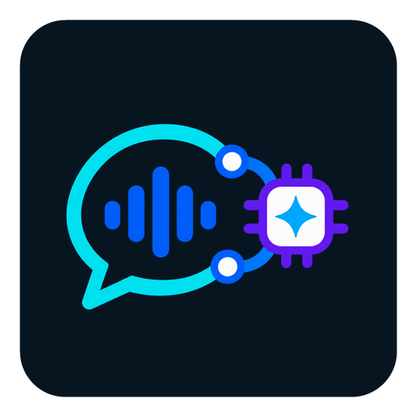

# Vox AI Relay



**Vox AI Relay** to natywny komunikator głosowy i tekstowy dla Androida, obsługujący **OpenClaw Gateway** oraz **Hermes Agent**. Przełącznik backendu jest stale widoczny, a aplikacja pamięta ostatni wybór.

## Najważniejsze funkcje

- rozmowa tekstowa i głosowa z OpenClaw albo Hermesem;
- strumieniowe wyświetlanie odpowiedzi;
- odczytywanie kolejnych zdań przez Android TTS jeszcze przed zakończeniem całej odpowiedzi;
- preferowane lokalne rozpoznawanie mowy Androida;
- ciągłość rozmowy i odtwarzanie historii z serwera;
- zdjęcia, aparat, pliki oraz PDF;
- Vision Hermesa i lokalne renderowanie stron PDF;
- powiadomienia OpenClaw oraz opcjonalne powiadomienia Hermesa przez `ntfy`;
- polski i angielski interfejs, jasny i ciemny motyw;
- możliwość wybrania Vox AI Relay jako asystenta Androida.

## OpenClaw

Połączenie OpenClaw korzysta z uwierzytelnionego protokołu WebSocket Gateway:

- tożsamość urządzenia Ed25519 i parowanie;
- `chat.history`, `chat.send` oraz `chat.abort`;
- historia rozmów przechowywana przez Gateway;
- strumieniowe odpowiedzi i kontrola właściwej sesji;
- obsługa zdjęć i plików;
- ostatnie rozmowy oraz automatyczna nowa sesja po ustalonej bezczynności;
- opcjonalny węzeł powiadomień i pilne alarmy;
- automatyczne ponawianie połączenia.

Gateway OpenClaw jest źródłem prawdy dla historii. Aplikacja nie tworzy niezależnej bazy rozmów.

## Hermes

Połączenie Hermes korzysta bezpośrednio z chronionego kluczem serwera API:

- strumieniowe `/v1/chat/completions`;
- trwały transkrypt przez `X-Hermes-Session-Id`;
- osobny `X-Hermes-Session-Key` dla pamięci długoterminowej;
- wczytywanie ostatnich wiadomości z serwera;
- wykrywanie rozumowania i działań narzędzi;
- prawdziwe przerwanie aktywnego strumienia SSE;
- Vision dla zdjęć;
- PDF zamieniany lokalnie na uporządkowane obrazy stron;
- opcjonalne powiadomienia push przez prywatny temat `ntfy`.

## Funkcje głosowe telefonu

### Rozpoznawanie mowy

Aplikacja używa Android `SpeechRecognizer`. Jeżeli telefon i wybrany język obsługują rozpoznawanie na urządzeniu, jest ono preferowane. Przejście na usługę sieciową następuje tylko po włączeniu odpowiedniej opcji.

Nagranie obsługuje systemowa usługa rozpoznawania Androida. Do OpenClaw lub Hermesa aplikacja wysyła rozpoznany tekst, a nie własny plik audio.

### Czytanie odpowiedzi

Android `TextToSpeech` zaczyna mówić po otrzymaniu pierwszego pełnego zdania. Następne zdania są dodawane do kolejki podczas dalszego generowania odpowiedzi. Dostępne są przyciski wyciszenia, zatrzymania i powtórzenia.

### Przerywanie

- **Kwadrat:** przerywa generowanie odpowiedzi oraz TTS, ale nie włącza mikrofonu.
- **Mikrofon:** przerywa generowanie i TTS, a następnie natychmiast uruchamia rozpoznawanie mowy.
- Widoczny fragment przerwanej odpowiedzi pozostaje na ekranie.

### Asystent systemowy

Vox AI Relay może zostać wybrany jako asystent Androida. To, czy długie naciśnięcie przycisku sprzętowego uruchomi aplikację, zależy od producenta telefonu i jego oprogramowania.

## Zdjęcia i PDF

- maksymalnie 5 załączników;
- maksymalnie 20 MB na plik i 30 MB łącznie;
- Hermes przyjmuje zdjęcia jako Vision;
- PDF dla Hermesa jest renderowany na telefonie: maksymalnie 24 strony, dłuższy bok 1800 pikseli;
- OpenClaw otrzymuje obsługiwane pliki przez Gateway;
- pliki audio, wideo i APK są odrzucane.

## Budowanie

Wymagane są Android Studio, JDK 17 oraz Android SDK 36.

```powershell
$env:JAVA_HOME = "C:\Program Files\Android\Android Studio\jbr"
.\gradlew.bat testDebugUnitTest assembleDebug
```

Gotowy APK znajduje się w `app/build/outputs/apk/debug/app-debug.apk`.

## Prywatność

- klucze i tokeny są chronione magazynem opartym na Android Keystore;
- aplikacja nie zawiera reklam ani analityki;
- lokalne STT jest preferowane;
- sieciowe STT wymaga świadomego włączenia;
- niezaufane TLS jest dostępne wyłącznie w kompilacji debug do testów.

Szczegóły: [PRIVACY.md](PRIVACY.md).

## Zgodność aktualizacji

Identyfikator `pl.marcin.openclaw` pozostaje bez zmian, aby aktualizacja nie usuwała konfiguracji, sparowanej tożsamości ani zapisanych kluczy. Nazwa widoczna dla użytkownika to **Vox AI Relay**.

